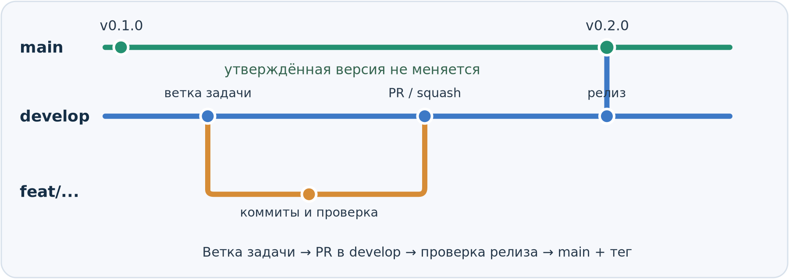

# Дорожная карта разработки

Planning Poker \| версия 2.2 для обсуждения командой \| 15.10.2026

Документ определяет последовательность развития продукта, уровни готовности функций и ожидаемый результат каждой итерации. Он служит общим ориентиром для команды: что мы стремимся получить и как будем проверять продвижение.

Конкретные работы и приоритеты для ближайших спринтов ведутся отдельно — в «Плане наполнения спринтов». Требования к поведению системы, правила сценариев и исключения уточняются системным аналитиком в аналитической спецификации. Дорожная карта не дублирует эти документы.

# 1. Подход к разработке

Разработка идёт короткими итерациями вокруг пользовательских сценариев. В каждой итерации команда стремится получить проверяемый результат, который можно запустить и продемонстрировать. Функции развиваются постепенно: сначала определяется их место в продукте, затем появляется минимальная рабочая версия, а после — дополнительные возможности и устойчивость.

Мы не строим сначала все экраны, затем всю серверную часть и только в конце интегрируем их. Приоритетный сценарий прорабатывается сквозным образом — от интерфейса до сохранённых данных. При этом разные функции вправе находиться на разных уровнях зрелости в одном спринте.

## 1.1. Уровни реализации L1–L3

L1, L2 и L3 описывают степень реализации конкретной функции. Это не фазы жизненного цикла проекта, не оценка сложности задачи и не условия её допуска в работу (DoR). Уровень задаёт границу ожидаемого результата, которую команда указывает при планировании.

| **Уровень**                              | **Смысл уровня**                                                                                                                                                                                                 | **Когда применять**                                                                                             |
|------------------------------------------|------------------------------------------------------------------------------------------------------------------------------------------------------------------------------------------------------------------|-----------------------------------------------------------------------------------------------------------------|
| L1 — каркас / интерфейсный контур        | В интерфейсе предусмотрено место функции, понятен её будущий вход и выход. Основная бизнес-логика может отсутствовать; неработающая часть явно показана как ограниченная или недоступная.                        | Когда важно согласовать расположение и переходы либо подготовить место для возможности, которая появится позже. |
| L2 — минимально работающая функция       | Основной сценарий действительно работает с реальными данными, выдаёт и сохраняет ожидаемый результат. Есть необходимая проверка вводимых данных и базовых ошибок, но допустимы заранее обозначенные ограничения. | Когда функция требуется для демонстрации текущего сквозного сценария или обеспечивает его обязательный шаг.     |
| L3 — расширенная / устойчивая реализация | Работающая функция дополнена согласованными вариантами поведения, граничными случаями, восстановлением после сбоев, удобством и более полной обработкой ошибок.                                                  | Когда основной сценарий уже надёжен и требуется закрыть дополнительные потребности продукта.                    |

Наличие красивого макета ещё не означает L2. И наоборот, L2 не требует полной реализации всех кнопок, которые уже нарисованы в Figma. Границы текущего уровня должны быть очевидны и разработчику, и тому, кто проверяет результат.

## 1.2. Примеры развития функций

| **Функция**          | **L1 — контур**                                                               | **L2 — рабочая основа**                                                                                                   | **L3 — развитие**                                                                                                            |
|----------------------|-------------------------------------------------------------------------------|---------------------------------------------------------------------------------------------------------------------------|------------------------------------------------------------------------------------------------------------------------------|
| Импорт CSV           | Окно импорта, выбор файла и макет списка задач.                               | CSV читается по согласованному шаблону; задачи показаны списком до подтверждения; после подтверждения попадают в очередь. | Валидация сложных случаев, дубликаты, ошибки отдельных строк, варианты входных файлов и понятная диагностика.                |
| Оценка задач         | Экран задачи и набор карт SP без полноценной записи результата.               | Host выбирает числовую карту, вручную подтверждает итог и видит сохранённую оценку в результатах.                         | Совместные голоса, изменение выбора, особые карты, таймер, переголосование и обработка отключений по согласованным правилам. |
| Подсказки из истории | На экране задачи выделена область рекомендаций с явно обозначенной заглушкой. | Реальный поиск по локальному набору эталонов возвращает похожие задачи, их SP и доступные ссылки.                         | Улучшение качества поиска, обработка сложных запросов, проверка релевантности и производительности.                          |
| Итоги сессии         | Предусмотрена структура итоговой страницы и таблицы.                          | Выводятся фактические задачи и сохранённые итоговые SP; ещё недоступные показатели обозначены прочерком.                  | Статистика голосов, комментарии, экспорт, ссылки и согласованные интеграции.                                                 |

Примеры показывают развитие возможностей, а не закрепляют их за строго определёнными спринтами. Например, часть расширений голосования станет целью второго спринта, а таймер и переголосование — более позднего. Разбивка зависит от приоритетного пользовательского результата.

## 1.3. Правила применения уровней

- Для выбранной функции обозначаем целевой уровень и его конкретные ограничения: что должно работать сейчас, а что явно остаётся на будущее.

- Обязательное звено демонстрируемого сценария должно быть рабочим на L2; наличие L1-заглушки не считается выполнением такого звена.

- Второстепенную область допустимо оставить на L1, если она не мешает основному сценарию и не создаёт ложного впечатления работоспособности.

- Переход к L3 имеет смысл после проверки L2 и определения действительно нужных расширений. Не всякая функция обязана немедленно достигнуть L3.

# 2. Готовность задач: DoR и DoD

Для одинакового понимания «задача готова» команда использует два различных ориентира. Они применяются к задачам внутри спринтов и не заменяют выбор уровня L1–L3.

| **Понятие**               | **Что означает**                                                                                    | **Главный вопрос**                                       |
|---------------------------|-----------------------------------------------------------------------------------------------------|----------------------------------------------------------|
| DoR — Definition of Ready | Условия, при которых задача достаточно понятна и подготовлена, чтобы команда взяла её в разработку. | Можем ли мы начинать работу без критических неизвестных? |
| DoD — Definition of Done  | Общие условия, при которых реализованную задачу можно признать законченной на согласованном уровне. | Можно ли проверить и принять результат как завершённый?  |

## 2.1. Definition of Ready — готовность к разработке

Задача соответствует DoR, когда понятно её назначение, границы и способ проверки. Это не требование заранее детализировать весь продукт: достаточно проработать выбранную работу настолько, чтобы не начинать реализацию вслепую.

- Понятна пользовательская или техническая цель и связь с текущим результатом спринта.

- Определён целевой уровень реализации (L1, L2 или L3) и перечислены ограничения данного уровня.

- Есть проверяемые критерии приёмки: какие действия должны приводить к какому результату.

- Доступны необходимые макеты или описание поведения; аналитик уточнил критичные правила и состояния.

- Известны данные, интеграции и зависимости; если необходим API, определены его контракт или порядок согласования.

- Объём задачи понятен настолько, чтобы оценить его и проверить по завершении; ясны ответственные за оставшиеся уточнения.

## 2.2. Definition of Done — завершённость работы

DoD проверяется для согласованного объёма задачи. Так, L2-импорт можно считать завершённым без поддержки Excel или YouTrack, если они не входят в его критерии. Но нельзя считать его завершённым, когда очередь по-прежнему заполняется вручную в том или ином виде вместо реального импорта.

- Реализовано обещанное поведение выбранного уровня; незаявленные заглушки отсутствуют.

- Критерии приёмки пройдены; обработаны базовые ошибки и состояния, которые требуются на данном уровне.

- Если задача охватывает клиент и сервер, обе части интегрированы и проверены на общем сценарии.

- Результат доступен в общей сборке/ветке команды и не нарушает ранее работавшие ключевые сценарии.

- Известные ограничения явно обозначены; при изменении API, запуска или правил обновлена соответствующая документация.

## 2.3. Пример применения DoR, уровня и DoD

Пример: «Импорт задач из CSV — L2». Ожидаемый результат: ведущий выбирает файл, видит список распознанных задач до подтверждения и после подтверждения получает их в очереди. Ограничение: только согласованный CSV-шаблон, без Excel и YouTrack.

До начала работы (DoR): согласованы обязательные поля CSV, правила обработки невалидного файла, макет предварительного просмотра и договорённость о передаче задач на сервер. После работы (DoD): сценарий проходит на тестовом CSV; отмена не меняет очередь, подтверждение создаёт реальные задачи, ошибка файла отображается пользователю, изменения интегрированы и проверены.

# 3. Последовательность итераций

План ниже задаёт крупные функциональные результаты, а не перечень назначенных исполнителям задач. Продолжительность и точный объём каждого спринта определяются отдельно после оценки доступной ёмкости команды и зависимостей.

| **Этап**                        | **Ожидаемый результат**                                                                                                                                                                                  | **Что сознательно откладываем**                                                                |
|---------------------------------|----------------------------------------------------------------------------------------------------------------------------------------------------------------------------------------------------------|------------------------------------------------------------------------------------------------|
| Подготовка                      | Рабочее окружение и общие соглашения позволяют команде начать совместную разработку. Уточняется ближайший сценарий, минимальный CSV и начинается исследование поиска эталонов.                           | Полная детализация всех будущих функций до начала работы.                                      |
| Спринт 1 — один Host            | Рабочая цепочка: создание серверной сессии → CSV с предварительным просмотром → очередь для просмотра → выбор и подтверждение SP ведущим → переход между задачами → реальные итоги.                      | Подключение участников, совместное голосование, управление очередью и реальный поиск эталонов. |
| Спринт 2 — совместная оценка    | Participant присоединяется по коду/ссылке; участники видят общую сессию, отдают голоса; Host видит результаты и вручную фиксирует итог. Появляется базовая статистика по согласованным числовым голосам. | Полное управление очередью, таймер и расширенный сценарий обсуждения.                          |
| Спринт 3 — управление процессом | Ведущий добавляет задачи, меняет очередь и пропускает задачу без потери; доступны комментарии. Поиск эталонов возвращает реальные рекомендации из подготовленного набора данных.                         | Расширенная механика времени и переголосования.                                                |
| Спринт 4 — гибкий раунд         | Таймер, предусмотренные правила окончания голосования, продление, досрочное завершение, специальные карты и переголосование. Проверяются переходы и нетипичные ситуации.                                 | Внешние интеграции и дополнительные форматы обмена.                                            |
| Спринт 5 — завершение продукта  | Экспорт CSV, согласованные расширения импорта, опциональная интеграция YouTrack, доведение пользовательского опыта, регрессионные проверки и документация для передачи.                                  | Дополнительные возможности сверх согласованного объёма приёмки.                                |

# 4. Как проверяется результат итерации

У каждого спринта должен быть демонстрируемый сценарий, показывающий полезный результат, а не только набор готовых компонентов. Примеры проверок ниже задают ожидаемый эффект; детальные критерии для отдельных задач определяются при наполнении спринта и в спецификации.

- После спринта 1: ведущий создаёт сессию, импортирует задачи из CSV, оценивает несколько задач и получает сохранённые итоги; обновление страницы не уничтожает серверные данные.

- После спринта 2: ведущий и участник в разных браузерах входят в одну сессию, голосуют и видят общий подтверждённый результат.

- После спринта 3: в ходе оценки можно добавить задачу, изменить очередь, пропустить и позднее оценить задачу, оставить комментарий и увидеть рекомендации по похожим задачам.

- После спринта 4: воспроизводятся обычное завершение голосования, истечение таймера, допустимые продления, досрочное завершение и повторное голосование.

- После спринта 5: полный согласованный сценарий запускается по инструкции; результаты можно экспортировать, а реализация проходит итоговую проверку.

# 5. Контрольные точки и корректировка курса

Начало первого спринта — 19 октября 2026 года. 30 октября 2026 года — контрольная дата отчёта о достигнутом состоянии, а не автоматически конец первого спринта. К этой дате команда показывает реально готовую часть целевого сценария и обозначает оставшийся объём.

При изменении сроков или доступности участников сначала защищается целостность главного пользовательского сценария. Необязательные расширения можно переносить, не выдавая каркас L1 за готовую реализацию L2. Рискованные направления — прежде всего поиск эталонов и внешние интеграции — проверяются заранее, чтобы поздно обнаруженная зависимость не сорвала завершение продукта.

# 6. Как использовать дорожную карту

Перед каждым спринтом руководитель проекта предлагает приоритетные функциональные результаты и формирует их конкретное наполнение в отдельном плане спринтов. Команда оценивает объём, зависимости и доступность и подтверждает достижимую цель. Тимлид координирует техническую декомпозицию, интеграцию и распределение задач между исполнителями. Системный аналитик уточняет поведение выбранных функций и актуализирует аналитическую спецификацию.

Дорожная карта пересматривается, если меняется последовательность крупных результатов или цель итерации. Уточнения требований, схем данных и отдельных правил не должны автоматически превращать её в подробную спецификацию.

# 7. Совместная разработка, репозиторий и релизы

Раздел устанавливает единые правила внесения изменений в код, проверки результатов, подготовки релизов и хранения проектных материалов. Он применяется всеми участниками разработки; конкретные технические инструменты выбираются с учётом стека проекта. Эти договорённости дополняют, но не заменяют DoR и DoD.

## 7.1. Назначение веток и движение изменений

Используется упрощённая модель GitFlow с двумя постоянными ветками: main и develop. Цель разделения — одновременно сохранять проверенную версию продукта и интегрировать функциональность текущего спринта.

| **Ветка**     | **Назначение и правила**                                                                                                                                                                                           |
|---------------|--------------------------------------------------------------------------------------------------------------------------------------------------------------------------------------------------------------------|
| main          | Содержит только принятые версии продукта. В течение текущего спринта остаётся на последнем утверждённом релизе. Прямые push и принудительное изменение истории запрещены.                                          |
| develop       | Содержит совместно интегрированные изменения текущей разработки. Не вся функциональность в ней обязана быть включена в релиз, но ветка должна оставаться собираемой, а уже работающие сценарии не должны ломаться. |
| Рабочие ветки | Создаются от актуальной develop под отдельную задачу. В них допускаются промежуточные коммиты; интеграция в develop осуществляется через Pull Request.                                                             |

Схема жизненного цикла изменений. Временные ветки создаются от develop; перенос в main выполняется только для принятого релиза.

## 7.2. Имена веток и коммитов

Имя рабочей ветки отражает вид и назначение работы. Формат: type/short-description; слова в кратком описании разделяются дефисами. При наличии трекера задач допустимо добавлять идентификатор задачи, например feat/42-session-creation.

| **Тип**  | **Для чего используется**                               | **Пример ветки**      |
|----------|---------------------------------------------------------|-----------------------|
| feat     | Новая пользовательская или техническая функциональность | feat/csv-import       |
| fix      | Исправление ошибки в текущей разработке                 | fix/session-reconnect |
| refactor | Изменение внутренней структуры без изменения поведения  | refactor/voting-state |
| docs     | Обновление документации                                 | docs/setup-guide      |
| test     | Добавление или исправление тестов                       | test/csv-validation   |
| chore    | Настройка окружения и вспомогательные изменения         | chore/linter-setup    |

Для сообщений коммитов используется Conventional Commits — единый формат, позволяющий быстро понять назначение каждого изменения. Шаблон: type(scope): description. Здесь type — тип изменения, scope — необязательная область проекта в скобках, description — краткое описание того, что сделано. Если область не нужна, её опускают: type: description.

В отличие от названия ветки (она описывает всю задачу), сообщение коммита описывает одно конкретное изменение. Ниже примеры формата и значения основных типов.

| **Сообщение коммита**                        | **Назначение изменения**                                                            |
|----------------------------------------------|-------------------------------------------------------------------------------------|
| feat(session): add session creation endpoint | feat — новая функциональность. В данном случае добавлен API для создания сессии.    |
| fix(voting): prevent duplicate votes         | fix — исправлена ошибка: повторная отправка запроса не создаёт лишний голос.        |
| refactor(queue): extract sorting logic       | refactor — изменена структура кода очереди без изменения поведения.                 |
| docs: update local setup guide               | docs — обновлена инструкция по локальному запуску; scope необязателен.              |
| test(import): cover invalid CSV rows         | test — добавлены проверки некорректных строк при импорте.                           |
| chore: configure linting                     | chore — изменена настройка инструментов разработки, а не функциональность продукта. |

Описания коммитов пишем кратко и единообразно; для примеров выбран английский язык. При Squash and merge итоговое сообщение в develop должно отражать содержание всей объединённой задачи, а не случайный промежуточный коммит.

Изменения в своей рабочей ветке разрешено регулярно отправлять в удалённый репозиторий. Сам по себе push не означает готовность к слиянию или выпуску версии. Принудительная перезапись истории общих веток не допускается.

## 7.3. Pull Request, ревью и защита веток

Pull Request (PR) — запрос на включение изменений в общую ветку. Для задач текущего спринта PR создаётся из рабочей ветки в develop. Проверка PR распределяется между разработчиками: тимлид не обязан быть ревьюером каждого изменения.

- Для принятия PR нужно как минимум одно одобрение другого разработчика; автор не утверждает собственный PR. Блокирующие замечания должны быть устранены.

- Автор кратко описывает цель, реализованное поведение, способ проверки и известные ограничения. Для интерфейсных изменений по возможности прикладывает скриншот или короткое описание демонстрации.

- Перед слиянием должны быть выполнены действующие для проекта обязательные проверки. Если какая-то проверка пока не автоматизирована, автор и ревьюер проверяют затронутый сценарий вручную и отмечают способ проверки в PR.

- Изменения общих API-контрактов, моделей данных или соглашений об интеграции дополнительно согласуются с затронутыми разработчиками до слияния.

- Для рабочих веток применяется Squash and merge: промежуточная история задачи объединяется в один содержательный коммит в develop. После слияния использованную рабочую ветку можно удалить.

Для main и develop включается защита веток: запрет прямых push, принудительной перезаписи истории и обхода настроенных условий слияния. Исключения возможны только в согласованной процедуре, а не по усмотрению автора изменений.

## 7.4. Интеграция крупной функциональности частями

Объёмную функциональность рекомендуется разбивать на небольшие, технически совместимые изменения. Это уменьшает риск конфликтов и позволяет проверять интеграцию раньше, чем будет полностью готова пользовательская возможность. Разбиение не должно приводить к появлению заведомо сломанного основного сценария.

**Пример — импорт CSV.** Поочерёдно могут интегрироваться модель задачи и договорённый контракт, серверная обработка CSV, предварительный просмотр на клиенте, затем сквозной сценарий подтверждения импорта. Каждый шаг проходит собственный PR и проверку. До готовности всей функции незавершённый путь не должен выдавать себя за рабочий импорт.

Если промежуточное изменение затрагивает пользовательский путь, его можно изолировать: скрыть точку входа, использовать временно отключённый маршрут или согласованный feature flag (переключатель доступности функции). Простую небольшую задачу не требуется искусственно разбивать на множество PR.

## 7.5. Релизы, контроль продвижения и изменения плана

Релиз — это утверждённый функциональный результат, зафиксированный в main. Merge в develop и завершение календарного периода сами по себе релизом не являются. Решение о составе и выпуске релиза принимает руководитель проекта после командной проверки результата.

- Перед выпуском команда проверяет демонстрируемый пользовательский сценарий, согласованный DoD, работоспособность сборки и фактический состав изменений.

- После подтверждения готовности принятый набор изменений переносится в main. Для переноса между постоянными ветками используется merge commit, а не Squash and merge. Релиз отмечается Git-тегом, например v0.1.0, v0.2.0; это примеры, а не жёсткая привязка к номерам спринтов.

- Допустим выпуск согласованной работоспособной части результатов спринта. Перенос оставшихся задач, изменение объёма и срока фиксируются по решению руководителя проекта на основании причин, зависимостей и оценки команды.

- Гибкие сроки не означают свободное затягивание работы: цель спринта сохраняется, продвижение проверяется еженедельно, блокирующие обстоятельства сообщаются своевременно, а продление или сокращение объёма должно быть обосновано.

- Если develop содержит незавершённую работу, её нельзя без проверки целиком переносить в main. Используются изоляция функции, исключение незавершённых изменений из состава выпуска либо при необходимости временная ветка release/.... Обязательная release-ветка для каждого спринта не вводится.

Если релиз не соответствует условиям принятия, main остаётся на последней утверждённой версии. Контрольная точка в ходе спринта допускает демонстрацию текущего состояния без выпуска новой версии.

## 7.6. Срочные исправления принятой версии

Для ошибки в утверждённой версии при необходимости создаётся ветка hotfix/... от main. После проверки исправление включается в main и фиксируется корректирующий релиз (например, v0.1.1). То же исправление обязательно переносится в develop, чтобы оно не было потеряно при следующем выпуске. Обычные ошибки текущей разработки исправляются через рабочие ветки от develop.

## 7.7. Документация и сопровождение материалов в репозитории

Репозиторий — общее место хранения и версионирования технических и командных материалов проекта: исходного кода, README, инструкций запуска, согласованных архитектурных схем, API-контрактов, описаний интеграций, тестовых соглашений и актуальных документов по разработке. Документация обновляется вместе с изменениями, которые делают её прежнюю версию неверной.

- Для документов и схем предусматривается понятная структура каталогов (например, docs/). Материалы хранятся в читаемых и, по возможности, редактируемых форматах; крупные изображения и выгрузки добавляются по необходимости.

- При ссылках на дизайн и внешнюю спецификацию указывается их актуальное расположение и статус. Не требуется дублировать в репозитории всё содержимое Figma или рабочую переписку.

- Токены, пароли, реальные файлы с секретами и приватные данные не помещаются в репозиторий. Для настроек окружения используется безопасный пример конфигурации.

- Первоначальная версия командной дорожной карты распространяется в чате. После создания репозитория дальнейшие актуальные версии дорожной карты и других согласованных проектных документов размещаются в нём; изменения отслеживаются через историю Git.

Создание общего репозитория, настройку доступа, основных веток и ограничений выполняет тимлид. Соблюдение правил коммитов, PR и актуализации затронутой документации — ответственность всех участников разработки.

Основание: описание заказчика, аналитическая спецификация, макеты Figma и согласованный командой итеративный подход.
