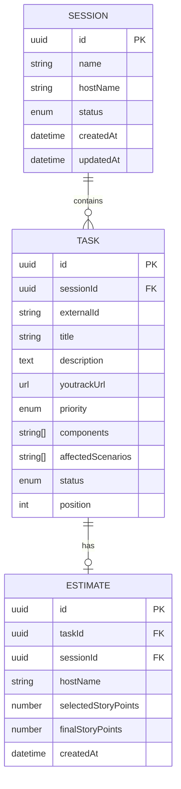
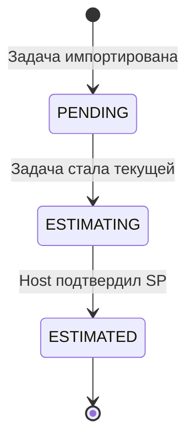

# Модель данных Planning Poker

**Задача:** PRE-03 — Определить модель данных для первого спринта  
**Владелец:** Системный аналитик  
**Связанные задачи:** S1-01–S1-06  
**Вход:** Утверждённая логическая архитектура из PRE-02  
**Статус:** Черновик для согласования  

**Связанные документы:**

- [API-контракт](api-specification.md)

## 1. Цель

Определить продуктовые правила данных для первого пользовательского сценария Planning Poker.

Модель данных должна обеспечить:

- создание сессии;
- импорт задач из CSV;
- просмотр очереди;
- получение текущей задачи;
- выбор и подтверждение итогового SP;
- получение итогов сессии;
- восстановление состояния после обновления страницы.

## 2. Границы модели данных

### В объёме

- Однопользовательский сценарий Host.
- Создание серверной сессии.
- Импорт задач из CSV.
- Оценка задач и фиксация итогового SP.
- Получение итогов сессии.
- Базовая обработка ошибок.

### Вне объёма

- Подключение Participant.
- Совместное голосование.
- Комментарии.
- Управление очередью.
- Таймер.
- Специальные карты.
- Переголосование.
- Поиск эталонов.
- Экспорт CSV.
- Интеграция с YouTrack.
- Импорт Excel.

## 3. Модель данных

### 3.1. Сущность `Session`

| Поле | Тип | Создание | Обязательность | Описание |
|---|---|---|---|---|
| `id` | `UUID` | Сервер | Да | Уникальный идентификатор сессии |
| `name` | `string` | Клиент | Да | Название сессии, 1–100 символов |
| `hostName` | `string` | Клиент | Да | Имя ведущего, 1–100 символов |
| `status` | `enum` | Сервер | Да | `CREATED`, `TASKS_IMPORTED`, `IN_PROGRESS`, `COMPLETED` |
| `createdAt` | `datetime` | Сервер | Да | Дата и время создания |
| `updatedAt` | `datetime` | Сервер | Да | Дата и время последнего изменения |

### 3.2. Сущность `Task`

| Поле | Тип | Создание | Обязательность | Описание |
|---|---|---|---|---|
| `id` | `UUID` | Сервер | Да | Внутренний идентификатор задачи |
| `sessionId` | `UUID` | Сервер | Да | Идентификатор родительской сессии |
| `externalId` | `string` | Клиент / CSV | Да | Идентификатор из YouTrack, до 50 символов |
| `title` | `string` | Клиент / CSV | Да | Заголовок задачи, 1–200 символов |
| `description` | `text` | Клиент / CSV | Да | Описание задачи, 1–10 000 символов |
| `youtrackUrl` | `URL` | Клиент / CSV | Да | Ссылка на задачу в YouTrack |
| `priority` | `enum` | Клиент / CSV | Нет | `Critical`, `High`, `Medium`, `Low`; по умолчанию `Medium` |
| `components` | `string[]` | Клиент / CSV | Да | `API`, `WEB` |
| `affectedScenarios` | `string[]` | Клиент / CSV | Да | `ЗАКАЗ`, `ВВОД` |
| `notes` | `text` | Клиент / CSV | Нет | Комментарии, до 5 000 символов |
| `tags` | `string[]` | Клиент / CSV | Нет | Свободные теги, до 10 значений |
| `initialStoryPoints` | `number` | Клиент / CSV | Нет | Исходная оценка из YouTrack |
| `finalStoryPoints` | `number` | Клиент | Нет | Итоговая оценка, фиксируется Host |
| `status` | `enum` | Сервер | Да | `PENDING`, `ESTIMATING`, `ESTIMATED` |
| `position` | `integer` | Сервер | Да | Позиция в очереди, начиная с `1` |

### 3.3. Сущность `Estimate`

| Поле | Тип | Создание | Обязательность | Описание |
|---|---|---|---|---|
| `id` | `UUID` | Сервер | Да | Идентификатор оценки |
| `taskId` | `UUID` | Сервер | Да | Идентификатор оценённой задачи |
| `sessionId` | `UUID` | Сервер | Да | Идентификатор сессии |
| `hostName` | `string` | Сервер | Да | Имя Host, зафиксировавшего оценку |
| `selectedStoryPoints` | `number` | Клиент | Да | Значение SP, выбранное Host |
| `finalStoryPoints` | `number` | Клиент | Да | Подтверждённое итоговое SP |
| `createdAt` | `datetime` | Сервер | Да | Дата и время фиксации оценки |

В первом срезе `selectedStoryPoints` и `finalStoryPoints` могут совпадать, так как Host одновременно выбирает и подтверждает итоговую оценку.

## 4. Связи сущностей



- Одна сессия содержит упорядоченный список задач.
- Одна задача относится к одной сессии.
- Одна задача имеет одну актуальную оценку в рамках первого сценария.
- Итоговый SP хранится в `Estimate` и дублируется в `Task.finalStoryPoints` для удобства отображения очереди и итогов.

## 5. Жизненный цикл задачи



| Статус | Описание | Переход |
|---|---|---|
| `PENDING` | Задача находится в очереди и ещё не оценивалась | В `ESTIMATING` при открытии задачи для оценки |
| `ESTIMATING` | Задача открыта, Host выбирает SP | В `ESTIMATED` после подтверждения SP |
| `ESTIMATED` | Итоговое SP зафиксировано | Финальный статус |

## 6. Шкалы и правила SP

### 6.1. Допустимые значения

Поддерживаемая шкала для первого спринта:

```text
0, 0.5, 1, 2, 3, 5, 8, 13, 20, 40, 100
```

### 6.2. Правила хранения

- `initialStoryPoints` хранится как исходное значение из CSV или YouTrack.
- `finalStoryPoints` хранится только после подтверждения Host.
- Значение SP должно точно соответствовать допустимой шкале.
- Пустое `initialStoryPoints` допустимо.
- Пустое `finalStoryPoints` допустимо только для задач в статусах `PENDING` и `ESTIMATING`.
- Для задачи в статусе `ESTIMATED` `finalStoryPoints` обязательно.
- Повторная оценка в первом срезе не поддерживается.

## 7. Разделение данных

| Данные | Источник | Хранение |
|---|---|---|
| `id` сессии | Сервер | Сервер |
| `status` сессии | Сервер | Сервер |
| Название сессии | Клиент | Сервер |
| Имя Host | Клиент | Сервер |
| Параметры задач | Клиент / CSV | Сервер |
| Порядок задач | Сервер | Сервер |
| Текущая задача | Сервер | Сервер |
| Выбор SP до подтверждения | Клиент | Клиент |
| Подтверждённое SP | Клиент | Сервер |
| Ошибки CSV | Сервер | Сервер формирует, UI отображает |
| Состояние модальных окон | Клиент | Клиент |

## 8. Критерии приёмки модели данных

- [ ] Определены поля `Session`, `Task` и `Estimate`.
- [ ] Зафиксированы обязательность, типы и источники данных.
- [ ] Описаны связи сущностей.
- [ ] Описан жизненный цикл задачи: `PENDING` → `ESTIMATING` → `ESTIMATED`.
- [ ] Определены допустимые значения шкалы SP.
- [ ] Зафиксированы правила хранения итогового SP.
- [ ] Определено разделение серверных и клиентских данных.
- [ ] Модель данных согласована с API-контрактом.
- [ ] Модель данных принята и передана в разработку.