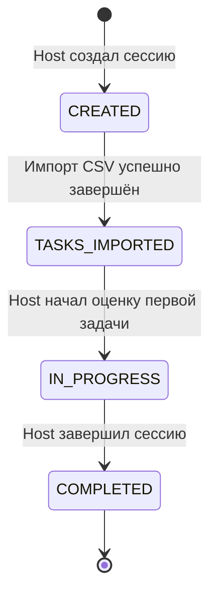
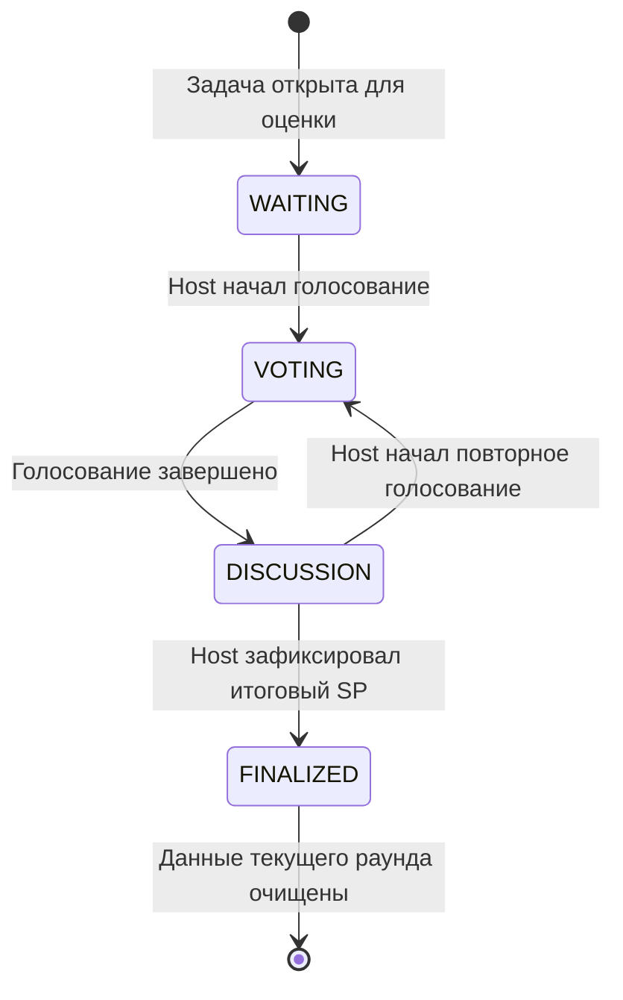
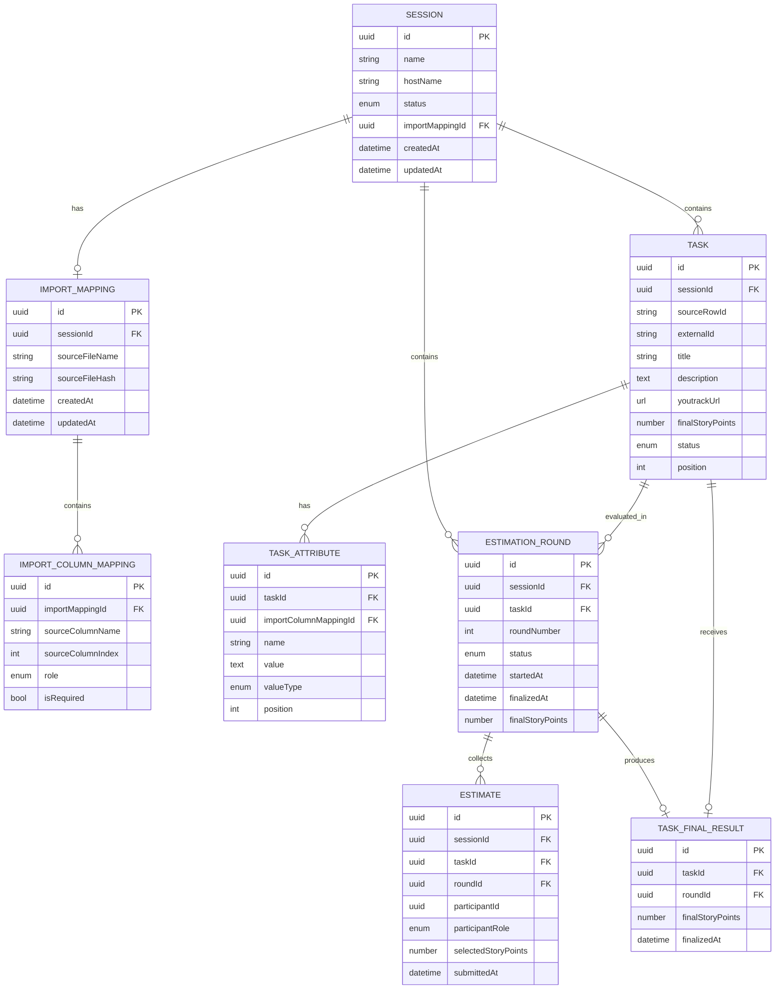
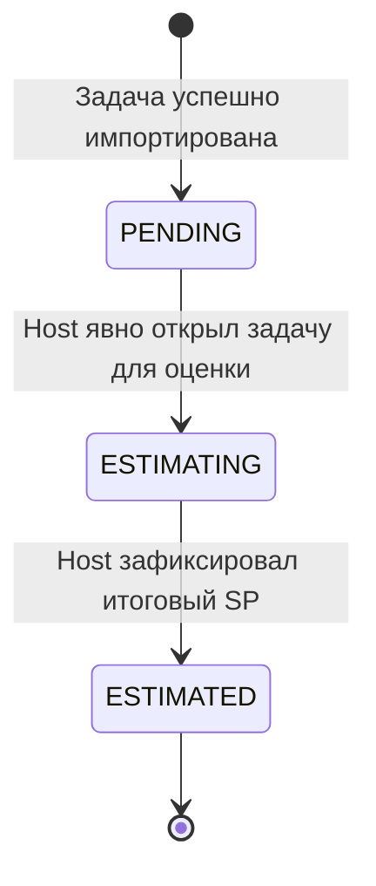

# Модель данных Planning Poker

**Задача:** PRE-03 — Определить модель данных для первого спринта  
**Владелец:** Системный аналитик  
**Связанные задачи:** S1-01–S1-06  
**Вход:** Утверждённая логическая архитектура из PRE-02  
**Статус:** Черновик после учёта ревью PM/PO  

**Связанные документы:**

- [API-контракт](api-specification.md)

## 1. Цель

Определить продуктовые правила данных для первого пользовательского сценария Planning Poker.

Модель данных должна обеспечить:

- создание сессии;
- импорт задач из CSV с пользовательской разметкой колонок;
- просмотр очереди;
- получение текущей задачи;
- выбор и подтверждение итогового SP;
- получение итогов сессии;
- восстановление состояния после обновления страницы.

## 2. Границы модели данных

### В объёме

- Однопользовательский сценарий Host.
- Создание серверной сессии.
- Импорт задач из CSV.
- Пользовательское сопоставление колонок исходного CSV ролям импорта.
- Хранение данных задачи, используемых при оценке.
- Хранение разметки импорта для последующего экспорта.
- Оценка задач и фиксация итогового SP.
- Получение итогов сессии.
- Базовая обработка ошибок.

### Вне объёма

- Подключение Participant.
- Совместное голосование.
- Комментарии.
- Управление очередью.
- Таймер.
- Специальные карты.
- Переголосование.
- Поиск эталонов.
- Экспорт CSV.
- Интеграция с YouTrack.
- Импорт Excel.

## 3. Принципы модели

1. **Сессия, раунд и задача — разные объекты.**  
   Статусы сессии описывают жизненный цикл всей сессии; статусы раунда — процесс оценки одной задачи; статусы задачи — её положение в очереди и факт наличия итоговой оценки.

2. **Данные задачи и разметка импорта разделены.**  
   Внутренняя задача хранит сведения, необходимые для оценки. Отдельно сохраняется разметка импорта: какие колонки исходного CSV пользователь назначил определённым ролям.

3. **Разметка CSV задаётся пользователем.**  
   Система не предполагает фиксированный перечень заголовков CSV. Пользователь назначает смысл колонкам в момент импорта.

4. **Дополнительные характеристики расширяемы.**  
   Приоритет, компоненты, затронутые сценарии, комментарии, теги и другие параметры не должны быть жёстко зашиты в модель как фиксированные поля с заранее известным перечнем значений.

5. **Голос и итоговая оценка — разные понятия.**  
   Голос — временный выбор участника в раунде. Итоговый SP — результат, который Host назначает задаче после завершения раунда.

## 4. Модель данных

### 4.1. Сущность `Session`

| Поле | Тип | Создание | Обязательность | Описание |
|---|---|---|---|---|
| `id` | `UUID` | Сервер | Да | Уникальный идентификатор сессии |
| `name` | `string` | Клиент | Да | Название сессии, 1–100 символов |
| `hostName` | `string` | Клиент | Да | Имя ведущего, 1–100 символов |
| `status` | `enum` | Сервер | Да | `CREATED`, `TASKS_IMPORTED`, `IN_PROGRESS`, `COMPLETED` |
| `importMappingId` | `UUID` | Сервер | Нет | Ссылка на разметку последнего успешного импорта CSV |
| `createdAt` | `datetime` | Сервер | Да | Дата и время создания |
| `updatedAt` | `datetime` | Сервер | Да | Дата и время последнего изменения |

### Жизненный цикл сессии



| Статус | Описание | Событие перехода |
|---|---|---|
| `CREATED` | Сессия создана, задачи ещё не импортированы | Создание сессии |
| `TASKS_IMPORTED` | CSV успешно импортирован, задачи доступны в очереди | Успешное завершение импорта CSV |
| `IN_PROGRESS` | Сессия находится в процессе оценки задач | Явное начало оценки первой задачи Host |
| `COMPLETED` | Сессия завершена | Явное действие Host «Завершить сессию» |

**Правила:**

- Переход `CREATED → TASKS_IMPORTED` происходит только после успешной валидации и сохранения импортированных задач.
- Переход в `IN_PROGRESS` выполняется явным действием Host, а не чтением текущей задачи через API.
- `GET /tasks/current` не изменяет статус сессии.
- Переход в `COMPLETED` требует явного подтверждения Host.

### 4.2. Сущность `Task`

`Task` — внутренняя задача, созданная на основе строки исходного CSV и используемая для оценки.

| Поле | Тип | Создание | Обязательность | Описание |
|---|---|---|---|---|
| `id` | `UUID` | Сервер | Да | Внутренний идентификатор задачи |
| `sessionId` | `UUID` | Сервер | Да | Идентификатор родительской сессии |
| `sourceRowId` | `string` | Сервер | Да | Стабильная ссылка на строку исходного CSV для возможного будущего экспорта |
| `externalId` | `string` | Клиент / CSV | Да | Идентификатор задачи из колонки, назначенной ролью «ID задачи»; до 50 символов |
| `title` | `string` | Клиент / CSV | Да | Заголовок задачи из колонки, назначенной ролью «Заголовок»; 1–200 символов |
| `description` | `text` | Клиент / CSV | Нет | Описание задачи, если назначена соответствующая колонка; до 10 000 символов |
| `youtrackUrl` | `URL` | Клиент / CSV | Нет | Ссылка на задачу, если назначена соответствующая колонка |
| `finalStoryPoints` | `number` | Клиент | Нет | Итоговая оценка, зафиксированная Host |
| `status` | `enum` | Сервер | Да | `PENDING`, `ESTIMATING`, `ESTIMATED` |
| `position` | `integer` | Сервер | Да | Позиция в очереди, начиная с `1` |

**Правила:**

- `externalId` — это идентификатор из пользовательского CSV, а не исключительно идентификатор YouTrack.
- `description` и `youtrackUrl` необязательны.
- `finalStoryPoints` заполняется только после подтверждения Host.
- Значения колонки, назначенной ролью «Колонка назначения итоговых SP», при импорте игнорируются. Они не считаются исходными оценками текущей сессии.
- Если в исходном CSV нет колонки для будущей записи итоговых SP, пользователь вручную добавляет её в конец файла и повторно загружает CSV. Система показывает подсказку, но не создаёт колонку автоматически.
- При будущем экспорте значения из назначенной колонки могут быть заменены итоговыми SP. Пользователь должен быть предупреждён об этом при импорте.
- `sourceRowId` необходим, чтобы при будущем экспорте можно было сопоставить задачу с исходной строкой CSV. Конкретный механизм идентификации строки уточняется при проектировании.

### 4.3. Сущность `ImportMapping`

`ImportMapping` сохраняет пользовательскую разметку колонок исходного CSV.

| Поле | Тип | Создание | Обязательность | Описание |
|---|---|---|---|---|
| `id` | `UUID` | Сервер | Да | Идентификатор разметки импорта |
| `sessionId` | `UUID` | Сервер | Да | Идентификатор сессии |
| `sourceFileName` | `string` | Клиент | Да | Исходное имя загруженного CSV-файла |
| `sourceFileHash` | `string` | Сервер | Да | Хеш содержимого файла для контроля соответствия разметки и CSV |
| `createdAt` | `datetime` | Сервер | Да | Дата и время создания разметки |
| `updatedAt` | `datetime` | Сервер | Да | Дата и время последнего изменения разметки |

### Сущность `ImportColumnMapping`

| Поле | Тип | Создание | Обязательность | Описание |
|---|---|---|---|---|
| `id` | `UUID` | Сервер | Да | Идентификатор сопоставления колонки |
| `importMappingId` | `UUID` | Сервер | Да | Идентификатор родительской разметки |
| `sourceColumnName` | `string` | Клиент | Да | Точное исходное название колонки в CSV |
| `sourceColumnIndex` | `integer` | Сервер | Да | Порядковый номер колонки в исходном файле, начиная с `0` |
| `role` | `enum` | Клиент | Да | Роль, назначенная пользователем |
| `isRequired` | `boolean` | Сервер | Да | Признак обязательной роли |

**Допустимые роли:**

| Роль | Обязательность | Назначение |
|---|---|---|
| `TASK_ID` | Да | Внешний идентификатор задачи |
| `TITLE` | Да | Заголовок задачи |
| `FINAL_SP_TARGET` | Да | Колонка, в которую в будущем экспортируются итоговые SP |
| `DESCRIPTION` | Нет | Описание задачи |
| `YOUTRACK_URL` | Нет | Ссылка на задачу в YouTrack |
| `ATTRIBUTE` | Нет | Произвольная дополнительная характеристика |

**Правила:**

- Обязательные роли: `TASK_ID`, `TITLE`, `FINAL_SP_TARGET`.
- Одна исходная колонка может быть назначена только одной роли.
- Роль `FINAL_SP_TARGET` должна быть назначена ровно одной колонке.
- Роли `TASK_ID` и `TITLE` также назначаются ровно одной колонке каждая.
- Роль `ATTRIBUTE` может быть назначена нескольким колонкам.
- Исходные названия колонок могут быть на любом языке и не должны интерпретироваться системой по имени.
- Разметка сохраняется вместе с сессией и может использоваться при будущем экспорте.
- Экспорт CSV в первом спринте не реализуется.

### 4.4. Сущность `TaskAttribute`

`TaskAttribute` — расширяемая характеристика задачи, полученная из колонки с ролью `ATTRIBUTE`.

| Поле | Тип | Создание | Обязательность | Описание |
|---|---|---|---|---|
| `id` | `UUID` | Сервер | Да | Идентификатор характеристики |
| `taskId` | `UUID` | Сервер | Да | Идентификатор задачи |
| `importColumnMappingId` | `UUID` | Сервер | Да | Ссылка на сопоставление исходной колонки |
| `name` | `string` | Клиент / CSV | Да | Название характеристики из исходного CSV |
| `value` | `text` | Клиент / CSV | Нет | Значение характеристики из исходного CSV |
| `valueType` | `enum` | Сервер | Да | `STRING`, `NUMBER`, `BOOLEAN`, `DATE`, `LIST` |
| `position` | `integer` | Сервер | Да | Порядок отображения характеристики |

**Правила:**

- Количество характеристик не ограничивается заранее.
- Характеристики не имеют фиксированного перечня допустимых значений на уровне модели данных.
- Значение может быть пустым, если такая колонка присутствует в CSV, но не заполнена в строке.
- Приоритет, компоненты, затронутые сценарии, комментарии и теги могут быть представлены как `TaskAttribute`, если пользователь назначил им соответствующие колонки.
- Система не должна требовать конкретные названия или значения таких характеристик.

### 4.5. Сущность `Estimate`

`Estimate` — голос участника раунда. В первом спринте голос может фиксировать только Host, но модель не должна предполагать, что голос принадлежит исключительно ведущему.

| Поле | Тип | Создание | Обязательность | Описание |
|---|---|---|---|---|
| `id` | `UUID` | Сервер | Да | Идентификатор голоса |
| `sessionId` | `UUID` | Сервер | Да | Идентификатор сессии |
| `taskId` | `UUID` | Сервер | Да | Идентификатор оцениваемой задачи |
| `roundId` | `UUID` | Сервер | Да | Идентификатор раунда оценки |
| `participantId` | `UUID` | Сервер | Да | Идентификатор участника, подавшего голос |
| `participantRole` | `enum` | Сервер | Да | `HOST`, `PARTICIPANT` |
| `selectedStoryPoints` | `number` | Клиент | Да | Значение SP, выбранное участником и отправленное на сервер |
| `submittedAt` | `datetime` | Сервер | Да | Дата и время получения голоса сервером |

**Правила:**

- В первом спринте `participantRole` всегда равен `HOST`.
- Модель допускает несколько голосов для одного раунда, чтобы в будущем поддержать участников без полной замены сущности.
- `selectedStoryPoints` сохраняется только после успешной отправки голоса на сервер.
- Локальный выбор SP в интерфейсе до нажатия «Подтвердить» хранится только на клиенте и серверу не известен.
- Если соединение потеряно до подтверждения, сервер не имеет голоса пользователя.
- После успешного подтверждения голос сохраняется на сервере и доступен для восстановления состояния.

### 4.6. Сущность `EstimationRound`

`EstimationRound` — раунд оценки одной задачи.

| Поле | Тип | Создание | Обязательность | Описание |
|---|---|---|---|---|
| `id` | `UUID` | Сервер | Да | Идентификатор раунда |
| `sessionId` | `UUID` | Сервер | Да | Идентификатор сессии |
| `taskId` | `UUID` | Сервер | Да | Идентификатор оцениваемой задачи |
| `roundNumber` | `integer` | Сервер | Да | Номер раунда оценки задачи, начиная с `1` |
| `status` | `enum` | Сервер | Да | `WAITING`, `VOTING`, `DISCUSSION`, `FINALIZED` |
| `startedAt` | `datetime` | Сервер | Нет | Дата и время начала раунда |
| `finalizedAt` | `datetime` | Сервер | Нет | Дата и время фиксации итогового SP |
| `finalStoryPoints` | `number` | Клиент | Нет | Итоговый SP, выбранный Host по результатам раунда |

### Жизненный цикл раунда



| Статус | Описание | Событие перехода |
|---|---|---|
| `WAITING` | Задача открыта, но голосование не начато | Открытие задачи для оценки Host |
| `VOTING` | Участники могут отправлять голоса | Явное начало голосования Host |
| `DISCUSSION` | Голосование завершено, доступно обсуждение | Завершение голосования |
| `FINALIZED` | Host выбрал и зафиксировал итоговый SP | Подтверждение итогового SP Host |

**Правила:**

- В первом спринте раунд может проходить без таймера и без участников, кроме Host.
- Повторное голосование не входит в первый спринт, но переход `DISCUSSION → VOTING` оставлен как точка расширения.
- После `FINALIZED` итоговый SP присваивается задаче.
- Данные текущего раунда очищаются после фиксации результата, чтобы можно было начать оценку следующей задачи.
- Подробная история завершённых раундов и расширенная статистика в первом спринте не хранятся.

## 5. Связи сущностей



### Правила связей

- Одна сессия содержит упорядоченный список задач.
- Одна задача относится к одной сессии.
- Одна сессия имеет одну актуальную разметку импорта CSV.
- Одна разметка импорта содержит одно или несколько сопоставлений колонок.
- Одна задача может иметь несколько дополнительных характеристик.
- Одна задача может проходить один или несколько раундов оценки.
- Один раунд собирает один или несколько голосов.
- Один завершённый раунд формирует один итоговый результат.
- Одна задача имеет не более одного актуального итогового результата.

## 6. Жизненный цикл задачи



| Статус | Описание | Событие перехода |
|---|---|---|
| `PENDING` | Задача находится в очереди и ещё не оценивалась | Успешный импорт CSV |
| `ESTIMATING` | Задача открыта Host для оценки | Явное действие Host «Начать оценку задачи» |
| `ESTIMATED` | Итоговый SP зафиксирован | Подтверждение итогового SP Host |

**Правила:**

- `PENDING → ESTIMATING` происходит по явному действию Host, а не при чтении задачи.
- `GET /tasks/current` возвращает текущую задачу, но не переводит её в `ESTIMATING`.
- `ESTIMATING → ESTIMATED` возможен только после фиксации итогового SP.
- `ESTIMATED` является финальным статусом задачи в первом спринте.
- Повторная оценка в первом срезе не поддерживается.

## 7. Шкалы и правила SP

### 7.1. Допустимые значения

Поддерживаемая шкала для первого спринта:

```text
0, 0.5, 1, 2, 3, 5, 8, 13, 20, 40, 100
```

### 7.2. Правила хранения

- `finalStoryPoints` хранится только после подтверждения Host.
- Значение SP должно точно соответствовать допустимой шкале.
- Пустое `finalStoryPoints` допустимо для задач в статусах `PENDING` и `ESTIMATING`.
- Для задачи в статусе `ESTIMATED` `finalStoryPoints` обязательно.
- Значения колонки, назначенной ролью `FINAL_SP_TARGET`, при импорте игнорируются.
- `initialStoryPoints` не входит в обязательную модель первого спринта, поскольку исходные значения нигде не используются.
- При будущем экспорте итоговые SP записываются в колонку, назначенную ролью `FINAL_SP_TARGET`.
- Пользователь должен быть предупреждён, что экспорт может заменить существующие значения в этой колонке.

## 8. Разделение данных

| Данные | Источник | Хранение | Назначение |
|---|---|---|---|
| `id` сессии | Сервер | Сервер | Идентификация сессии |
| `status` сессии | Сервер | Сервер | Жизненный цикл всей сессии |
| Название сессии | Клиент | Сервер | Отображение и восстановление состояния |
| Имя Host | Клиент | Сервер | Отображение и восстановление состояния |
| Исходный CSV | Клиент | Сервер | Импорт задач и будущий экспорт |
| Разметка колонок CSV | Клиент | Сервер | Интерпретация импорта и будущий экспорт |
| Данные задачи для оценки | Клиент / CSV | Сервер | Оценка и отображение задачи |
| Дополнительные характеристики | Клиент / CSV | Сервер | Расширяемые сведения о задаче |
| Порядок задач | Сервер | Сервер | Очередь оценки |
| Текущая задача | Сервер | Сервер | Определение активной задачи |
| Раунд оценки | Сервер | Сервер | Жизненный цикл оценки одной задачи |
| Неподтверждённый выбор SP | Клиент | Клиент | Временное состояние интерфейса |
| Подтверждённый голос | Клиент | Сервер | Сохранение выбора после успешной отправки |
| Итоговый SP | Клиент | Сервер | Результат, назначенный задаче |
| Ошибки CSV | Сервер | Сервер формирует, UI отображает | Обработка ошибок импорта |
| Состояние модальных окон | Клиент | Клиент | Локальное состояние интерфейса |

## 9. Критерии приёмки модели данных

- [ ] Определены поля `Session`, `Task`, `ImportMapping`, `ImportColumnMapping`, `TaskAttribute`, `EstimationRound` и `Estimate`.
- [ ] Зафиксированы обязательность, типы и источники данных.
- [ ] Разделены данные задачи, разметка импорта CSV и дополнительные характеристики.
- [ ] Определены обязательные роли разметки CSV: `TASK_ID`, `TITLE`, `FINAL_SP_TARGET`.
- [ ] Определено, что значения колонки `FINAL_SP_TARGET` игнорируются при импорте.
- [ ] Описаны связи сущностей и их кардинальности.
- [ ] Разделены жизненные циклы сессии, раунда и задачи.
- [ ] Для каждого перехода указано конкретное событие.
- [ ] Подтверждено, что чтение текущей задачи не изменяет статус сессии или задачи.
- [ ] Определены допустимые значения шкалы SP.
- [ ] Зафиксированы правила хранения итогового SP.
- [ ] Разделены неподтверждённый выбор SP, подтверждённый голос и итоговый SP.
- [ ] Модель допускает несколько голосов в одном раунде без обязательной реализации многопользовательского сценария в S1.
- [ ] Определено разделение серверных и клиентских данных.
- [ ] Модель данных согласована с API-контрактом.
- [ ] Модель данных принята и передана в разработку.