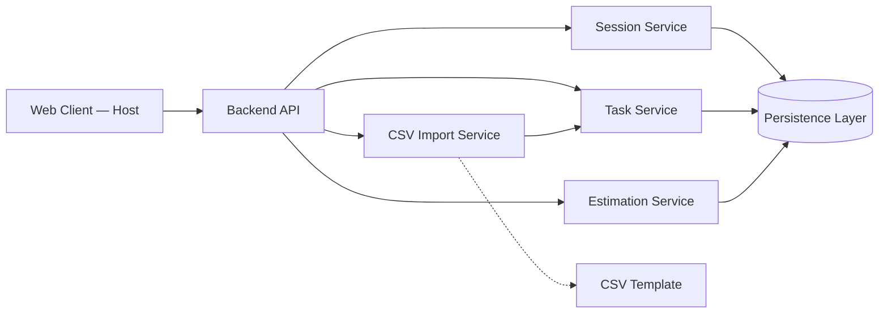
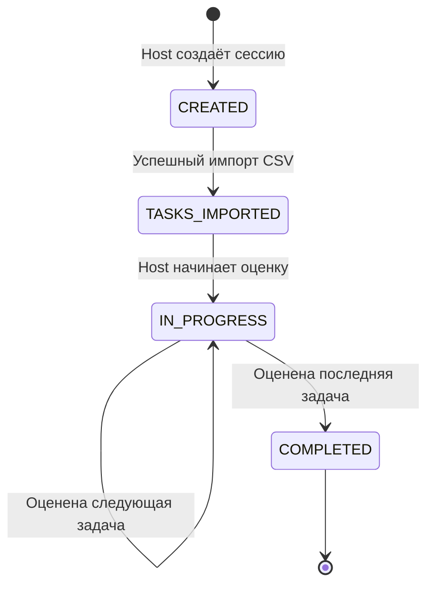
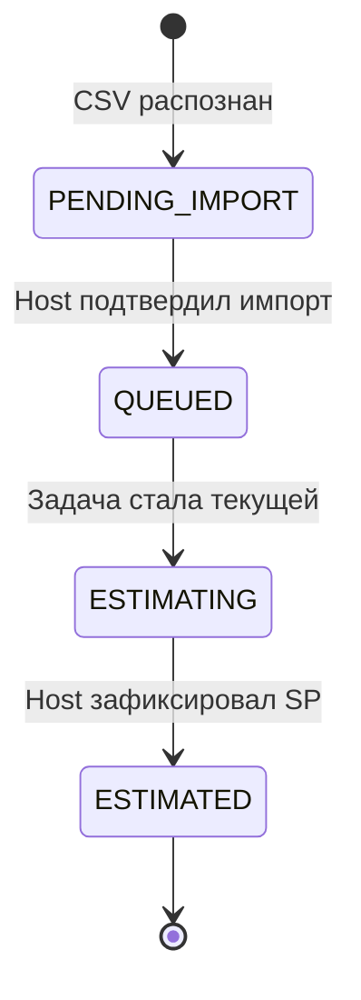
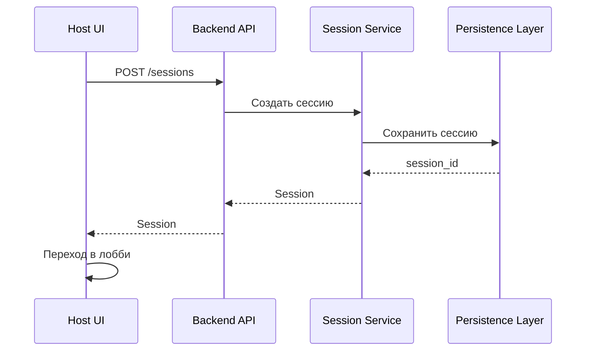
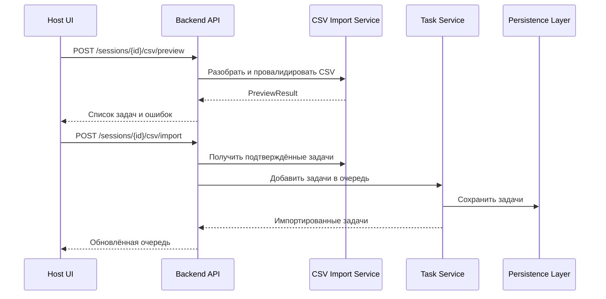
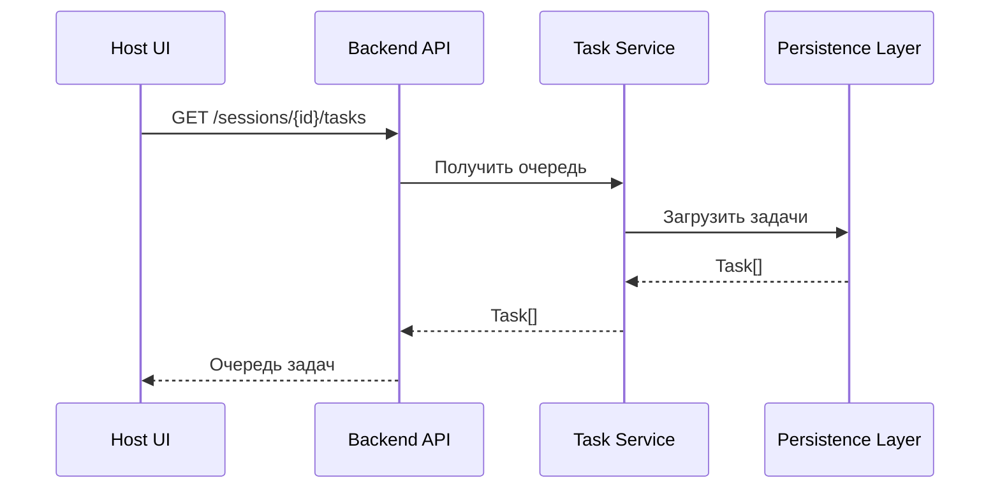
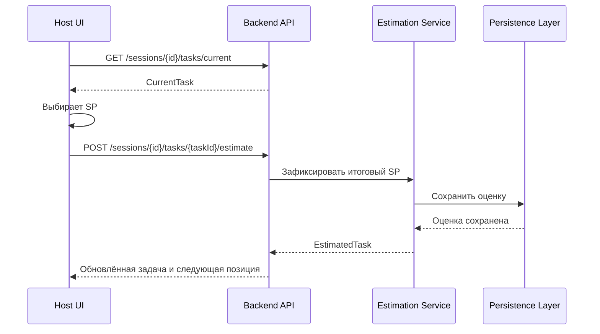
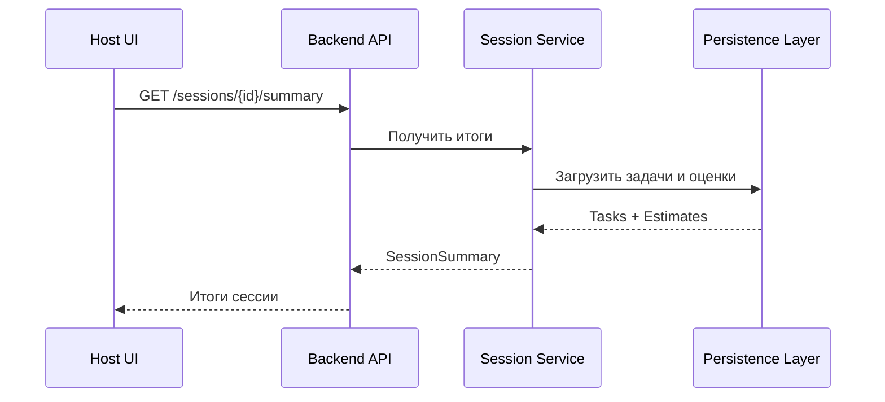

# Логическая архитектура Planning Poker

**Задача:** PRE-02 — Разработать логическую архитектуру приложения  
**Владелец:** Системный аналитик  
**Связанные задачи:** PRE-03 «Определить модель данных и интерфейсы взаимодействия для первого спринта»  
**Статус:** Черновик для согласования  

## 1. Цель

Сформировать единую логическую архитектуру первого рабочего среза Planning Poker и согласовать её с бэкендом и фронтендами.

Архитектура определяет основные компоненты, их ответственность, жизненный цикл сессии, потоки данных, серверные и клиентские данные, а также базовые правила обработки ошибок и восстановления состояния.

Результат PRE-02 является входом для PRE-03: на его основе определяются модель данных, связи сущностей и минимальные API-контракты.

## 2. Границы первого среза

Первый срез — однопользовательский сценарий Host:

1. Host создаёт сессию.
2. Host импортирует задачи из CSV.
3. Host просматривает очередь импортированных задач.
4. Host открывает текущую задачу.
5. Host выбирает значение Story Points.
6. Host подтверждает итоговую оценку.
7. Host переходит к следующей задаче.
8. После оценки всех задач Host просматривает итоги сессии.

### Вне объёма первого среза

- подключение Participant по коду или ссылке;
- совместное голосование нескольких участников;
- комментарии участников;
- управление очередью: добавление, удаление, перестановка, пропуск;
- таймер раунда;
- специальные карты;
- переголосование;
- поиск исторических эталонов;
- экспорт CSV;
- интеграция с YouTrack;
- импорт Excel.

## 3. Основные логические компоненты

| Компонент | Ответственность |
|---|---|
| **Web Client — Host** | Интерфейс ведущего: создание сессии, импорт CSV, просмотр очереди, оценка задач, подтверждение SP, просмотр итогов |
| **API Gateway / Backend API** | Единая точка входа для клиентских запросов; валидация запросов, авторизация операций, координация доменной логики |
| **Session Service** | Создание сессии, хранение состояния сессии, управление её жизненным циклом |
| **Task Service** | Импорт и хранение задач, формирование очереди, предоставление текущей задачи |
| **CSV Import Service** | Разбор CSV, валидация файла и строк, формирование задач для предпросмотра и подтверждённого импорта |
| **Estimation Service** | Приём выбора SP, временное хранение выбора, фиксация итоговой оценки |
| **Persistence Layer** | Сохранение сессий, задач, оценок и итоговых результатов |
| **CSV Template** | Эталонный шаблон файла и справочники допустимых значений |

## 4. Диаграмма компонентов

## 5. Жизненный цикл сессии

### 5.1. Состояния сессии

| Состояние | Описание |
|---|---|
| `CREATED` | Сессия создана, задач нет |
| `TASKS_IMPORTED` | В сессию импортирован хотя бы один CSV-файл |
| `IN_PROGRESS` | Начата оценка задач |
| `COMPLETED` | Все задачи получили итоговую оценку |

### 5.2. Переходы

### 5.3. Правила переходов

- Сессия создаётся в состоянии `CREATED`.
- После успешного подтверждения импорта сессия переходит в `TASKS_IMPORTED`.
- Оценка может начаться только при наличии хотя бы одной задачи.
- Во время оценки текущая задача определяется позицией в очереди.
- После подтверждения SP система переходит к следующей неоценённой задаче.
- Когда все задачи оценены, сессия переходит в `COMPLETED`.
- Повторное открытие страницы не создаёт новую сессию, а восстанавливает существующее серверное состояние.

## 6. Жизненный цикл задачи

| Состояние | Описание |
|---|---|
| `PENDING_IMPORT` | Задача распознана из CSV, но импорт ещё не подтверждён |
| `QUEUED` | Задача подтверждена и находится в очереди |
| `ESTIMATING` | Задача открыта для выбора SP |
| `ESTIMATED` | Host подтвердил итоговое значение SP |

## 7. Серверные и клиентские данные

| Данные | Хранение | Обоснование |
|---|---|---|
| Идентификатор сессии | Сервер | Сессия должна быть доступна после обновления страницы |
| Название сессии | Сервер | Общее состояние сессии |
| Роль и имя Host | Сервер | Необходимо для восстановления контекста |
| Список задач | Сервер | Очередь и оценки не должны теряться при обновлении |
| Порядок задач | Сервер | Определяет текущую и следующую задачу |
| Содержимое задачи | Сервер | Используется при оценке и в итогах |
| Выбранное, но не подтверждённое SP | Клиент | Временное состояние до подтверждения |
| Подтверждённое итоговое SP | Сервер | Является результатом оценки |
| Статус текущей задачи | Сервер | Обеспечивает восстановление после обновления |
| Ошибки валидации CSV | Клиент и сервер | Клиент показывает UX-ошибки, сервер является источником истины |
| Состояние модальных окон | Клиент | Локальное UI-состояние |
| Выбранный файл CSV | Клиент | Файл передаётся на сервер только при запросе разбора/импорта |

## 8. Потоки данных

### 8.1. Создание сессии

**Результат:** создаётся сессия в состоянии `CREATED`; Host получает идентификатор сессии и переходит в лобби.

### 8.2. Импорт CSV

**Правила:**

- Сначала выполняется предпросмотр без изменения очереди.
- Host подтверждает импорт только корректных строк.
- Ошибочные строки не сохраняются.
- После успешного импорта сессия переходит в `TASKS_IMPORTED`.
- Отмена на этапе предпросмотра не создаёт задач.

### 8.3. Просмотр очереди

**Результат:** Host видит актуальный список импортированных задач в порядке очереди.

### 8.4. Оценка задачи

**Правила:**

- Выбор SP до подтверждения остаётся локальным состоянием UI.
- Подтверждённое SP сохраняется на сервере.
- После подтверждения задача получает статус `ESTIMATED`.
- Система определяет следующую неоценённую задачу.

### 8.5. Получение итогов

**Результат:** Host видит список задач, итоговые SP и статус завершения сессии.

## 9. Обработка ошибок

| Ситуация | Реакция системы |
|---|---|
| Некорректный CSV | Импорт не выполняется; отображается ошибка файла и ссылка на шаблон |
| Ошибки в отдельных строках CSV | Корректные строки доступны для импорта, ошибочные — нет |
| Сессия не найдена | Ошибка «Сессия не найдена или завершена» |
| Попытка начать оценку без задач | Действие недоступно |
| Попытка подтвердить SP без выбранного значения | Действие недоступно |
| Сетевая ошибка при создании сессии | Пользователь остаётся на экране создания, отображается ошибка |
| Сетевая ошибка при импорте | Очередь не изменяется, отображается ошибка |
| Сетевая ошибка при подтверждении SP | Оценка не считается сохранённой, отображается ошибка |
| Обновление страницы | Клиент запрашивает актуальное состояние сессии у сервера |
| Потеря несохранённого выбора SP | Выбор сбрасывается; серверные данные не теряются |

## 10. Восстановление состояния

При открытии или обновлении страницы Host:

1. Передаёт идентификатор сессии.
2. Запрашивает актуальное состояние сессии.
3. Получает сессию, очередь, текущую задачу и сохранённые оценки.
4. Отображает соответствующий экран:
   - `CREATED` / `TASKS_IMPORTED` → лобби;
   - `IN_PROGRESS` → экран текущей задачи;
   - `COMPLETED` → экран итогов.

Несохранённый выбор SP не восстанавливается, так как он является локальным UI-состоянием.

## 11. Соответствие интерфейсу

Архитектура должна поддерживать следующие экраны и переходы:

| Экран | Архитектурная поддержка |
|---|---|
| Создание сессии | `POST /sessions`, создание `Session` |
| Лобби сессии | Получение сессии, очереди и количества задач |
| Модальное окно импорта | Предпросмотр CSV и подтверждённый импорт |
| Экран голосования | Получение текущей задачи, выбор и подтверждение SP |
| Экран обсуждения / фиксации оценки | Фиксация итогового SP |
| Итоги сессии | Получение сводки по задачам и оценкам |

## 12. Критерии приёмки PRE-02

- [ ] Описан пользовательский сценарий первого среза и его границы.
- [ ] Определены основные логические компоненты и зоны ответственности.
- [ ] Описан жизненный цикл сессии и переходы между состояниями.
- [ ] Описан жизненный цикл задачи.
- [ ] Зафиксированы серверные и клиентские данные.
- [ ] Описаны потоки данных для создания сессии, импорта, очереди, оценки, подтверждения и итогов.
- [ ] Определены базовые ошибки и правила восстановления состояния.
- [ ] Схема согласована с бэкендом и обоими фронтендами.
- [ ] Проверено соответствие архитектуры экранам и переходам из спецификации интерфейса.
- [ ] Утверждённая схема передана в PRE-03.